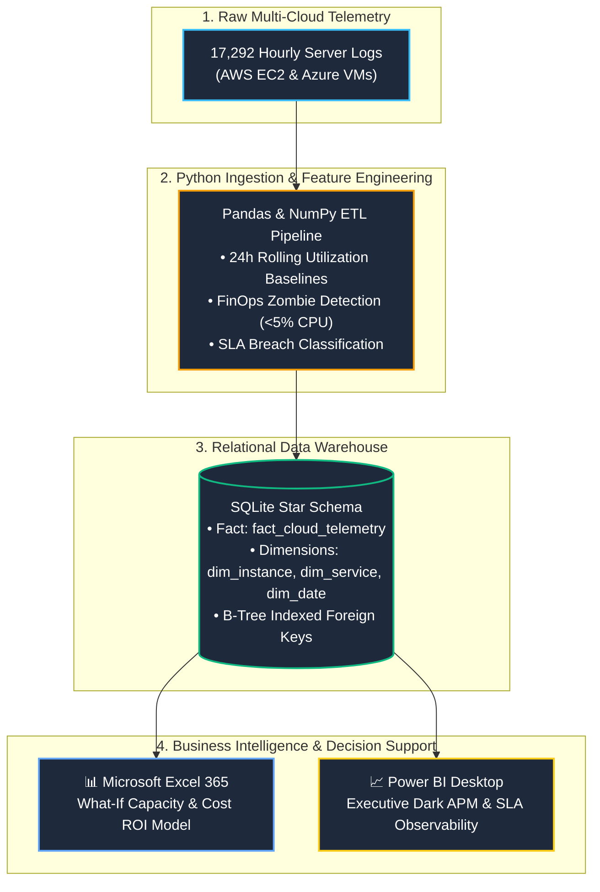

# ☁️ Enterprise Cloud FinOps & Infrastructure Reliability Analytics Platform
### *An End-to-End Analytics Suite: Python Simulation ETL ➔ SQL Star Schema ➔ Excel FinOps ➔ Power BI Observability*

[](python/02_data_cleaning_eda.py)
[](sql/01_schema_setup.sql)
[](Power_bi/Enterprise_Cloud_FinOps_PowerBI_Report.pdf)
[](excel/cloud_finops_capacity_model.xlsx)
[](https://1drv.ms/x/c/8603EE4E860307AB/IQDrQR2m8Y1HR76VquE5YVwGASKdlwENcyOvX0_FDv-EEQE?e=UhFmj2)
[](https://github.com/SAKTHIGANESH2004)

> An end-to-end enterprise Data Analytics platform powered by a **custom Python telemetry simulation engine** that models **17,292 hourly multi-cloud logs (AWS CloudWatch & Azure Monitor patterns)** across a 60-day billing cycle to detect idle compute cost leakage, diagnose memory leak anomalies, and model FinOps cost recovery.

---

## 👨‍💻 Project Author
* **Author:** **SAKTHIGANESH K**
* **Education:** B.E. Computer Science & Engineering (2025)
* **Role Focus:** Associate Data Analyst | Business Intelligence & Cloud Analytics
* **Links:** [LinkedIn Profile](https://www.linkedin.com) | [GitHub Portfolio](https://github.com/SAKTHIGANESH2004) | [Email](mailto:sakthiganeshk27@gmail.com)

---

## 📂 Quick Access to Project Source Code & Models

Click any asset below to directly view the source code, raw data, and dashboards in this repository:

| Module | Core Deliverable | Direct Repository Link (Click to Open) |
| :--- | :--- | :--- |
| 🗃️ **Raw & Cleaned Dataset** | 17,292-Row Full CSV Telemetry Data | [📁 `excel/cleaned_cloud_finops_data.csv`](excel/cleaned_cloud_finops_data.csv) |
| 🐍 **Python ETL & Data Pipeline** | Synthetic telemetry generator & EDA cleaning | [📁 `python/02_data_cleaning_eda.py`](python/02_data_cleaning_eda.py) |
| 🗄️ **SQL Modeling & Queries** | Star Schema DDL, Cost Leakage & RCA Queries | [📁 `sql/01_schema_setup.sql`](sql/01_schema_setup.sql) |
| 📊 **Power BI Visual Report** | 3-Page Executive Dark-Mode PDF Report | [📑 View Power BI Report (PDF)](Power_bi/Enterprise_Cloud_FinOps_PowerBI_Report.pdf) |
| 📈 **Power BI Model File** | Raw Power BI Data Model File | [💾 Download `Cloud_Enterprise_FinOps.pbix`](Cloud_Enterprise_FinOps.pbix) |
| 📑 **Excel Financial Model** | 3-Page What-If Capacity Model (.xlsx) | [📊 Download `excel/cloud_finops_capacity_model.xlsx`](excel/cloud_finops_capacity_model.xlsx) |
| 🌐 **Live Cloud Demo** | Interactive Web Browser Dashboard | [🚀 Launch Excel Online Interactive Dashboard](https://1drv.ms/x/c/8603EE4E860307AB/IQDrQR2m8Y1HR76VquE5YVwGASKdlwENcyOvX0_FDv-EEQE?e=UhFmj2) |

---

## 🧪 Telemetry Generation Methodology (Python Simulation Engine)

To replicate enterprise cloud environments without violating corporate NDAs or PII data privacy, a custom Python pipeline (`python/01_generate_telemetry_data.py`) was engineered to simulate realistic multi-cloud infrastructure behaviors:

* **Diurnal Traffic Curves:** Realistic daytime peak loads and nighttime drops modeled with sine-wave mathematical variations.
* **Zombie Server Simulation:** Non-production instances idling continuously at <5% CPU/RAM across 60 days.
* **Memory Leak Injection:** An escalating heap allocation pattern in `payment-gateway` (45% to 95% RAM saturation) triggering automated container crash-restarts and 5xx cascading failures.
* **Multi-Cloud Billing Math:** Accurate AWS On-Demand vs. Reserved Instance (RI) hourly blended pricing models.

---

## 📌 Executive Summary & Business Impact

Modern enterprise multi-cloud environments suffer from severe capital waste due to unmonitored non-production infrastructure and unhandled cascading microservice latency bottlenecks. 

This analytical platform models **17,292 hourly logs** across AWS and Azure infrastructure over a 60-day billing cycle:

* **💰 Total 60-Day Fleet Spend:** **$2,998.72**
* **🚨 Identified Cloud Waste:** **$1,279.61** (42.7% of total budget wasted on idle workloads)
* **🧟 Zombie Servers Identified:** **3 Unutilized Development Servers** running 24/7 with zero productive traffic.
* **📈 Addressable Annual Cost Recovery:** **$19,067 / Year** via automated decommissioning, staging rightsizing, and 1-Year Reserved Instances (RI).
* **⚡ SRE Outage Triaging:** Diagnosed an unhandled **Heap Memory Leak in `payment-gateway`** causing a 993-hour SLA breach and **14,702 HTTP 5xx error spikes** on AWS Production.

---

## 🏗️ Technical Architecture & Pipeline



---

## 📊 Analytical Deep Dive (3 Core Modules)

### 1️⃣ Module 1: Executive FinOps Overview
* **Donut Fleet Distribution:** Analyzed $2,070.72 AWS vs. $928.00 Azure infrastructure spend.
* **Environment Cost Bleed:** Uncovered that the **Development environment bled 100% of its budget ($1,280.00)** with <3% CPU utilization.
* **60-Day Daily Burn Rate:** Tracked steady $50/day fleet spend with an elevated $21.31/day waste bleed line.

### 2️⃣ Module 2: Application Performance Monitoring (APM) & SRE Observability
* **Microservice SLA Compliance:** Flagged `payment-gateway` (80% compliance) and `recommendation-engine` (50% compliance) breaching enterprise 99.9% uptime targets.
* **Memory Leak Sawtooth Pattern:** Isolated an escalating memory consumption pattern from 45% up to 95% RAM saturation triggering automated container crash-restarts.
* **Error Outage Concentration:** Isolated 14,702 HTTP 5xx server errors localized exclusively to AWS Production workloads.

### 3️⃣ Module 3: DevOps Zombie Resource Audit & Action Center
* **Action Matrix Breakdown:**
  * ⛔ **TERMINATE NOW:** 3 idle servers (`i-dev-sandbox-ml`, `i-dev-test01`, `vm-dev-legacy01`) recovering **$9,667 / year**.
  * ⚡ **CONVERT TO 1-YR RI:** 3 steady-state production workloads saving **$1,989.29 (32% discount)**.
  * ✔ **KEEP ON-DEMAND:** 6 variable staging & ephemeral notification microservices.

---

## 🗄️ SQL Star Schema Architecture

```sql
-- Fact Table: fact_cloud_telemetry
CREATE TABLE fact_cloud_telemetry (
    timestamp TEXT,
    date_key INTEGER,
    instance_id TEXT,
    service_name TEXT,
    cpu_utilization_pct REAL,
    memory_utilization_pct REAL,
    rolling_cpu_24h_avg REAL,
    rolling_ram_24h_avg REAL,
    network_io_mb REAL,
    p95_latency_ms REAL,
    request_count INTEGER,
    http_5xx_errors INTEGER,
    hourly_cost_usd REAL,
    wasted_cost_usd REAL,
    is_idle_zombie INTEGER,
    sla_breached INTEGER,
    health_status TEXT,
    FOREIGN KEY(instance_id) REFERENCES dim_instance(instance_id),
    FOREIGN KEY(date_key) REFERENCES dim_date(date_key)
);
```

---

## 📈 Financial Recovery Levers

| FinOps Optimization Lever | Monthly Savings | Annual Recovered ROI |
| :--- | :---: | :---: |
| 🧟 **Zombie Dev Server Decommission** | $805.60 / mo | **$9,667.20 / yr** |
| 📉 **Staging Instance Rightsizing** | $440.00 / mo | **$5,280.00 / yr** |
| 🔒 **Production 1-Year RI Commitments** | $343.33 / mo | **$4,120.00 / yr** |
| 💰 **TOTAL ADDRESSABLE FINOPS SAVINGS** | **$1,588.93 / mo** | **$19,067.20 / YR** |

---

## 💻 Local Setup & Execution

1. Clone the repository:
   ```bash
   git clone https://github.com/SAKTHIGANESH2004/cloud-finops-server-reliability.git
   cd cloud-finops-server-reliability
   ```
2. Navigate into the repository and install requirements:
   ```bash
   pip install pandas numpy
   ```
3. Run the complete ETL pipeline:
   ```bash
   python python/01_generate_telemetry_data.py
   python python/02_data_cleaning_eda.py
   python python/03_load_to_sqlite.py
   ```
4. Explore the dashboards:
   * Open `Cloud_Enterprise_FinOps.pbix` in **Power BI Desktop**.
   * Explore `excel/cloud_finops_capacity_model.xlsx` in **Microsoft Excel**.

---

⭐ *If you find this project insightful, please consider starring the repository!*
